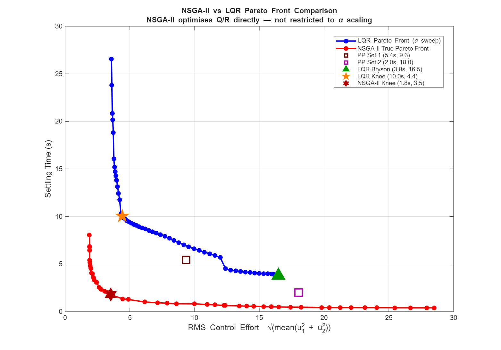

# CR3BP Spacecraft Control at Earth-Moon L2

Stabilisation of a spacecraft at the Earth-Moon L2 Lagrange point using the Circular Restricted Three-Body Problem (CR3BP) linearised dynamics. The work implements four control architectures: pole placement, LQR with Bryson's Method, LQR Pareto front analysis via alpha-scaling, and multi-objective Q/R optimisation via NSGA-II and compares them directly on mission-relevant metrics: settling time and RMS control effort.

---

## The Problem

L2 is an unstable equilibrium point as the spacecraft will drift away without active control. On top of that, persistent sinusoidal disturbances act on the system:

```
d₁ = 0.5 sin(t)
d₂ = cos(t + π/4)
```

The controller must simultaneously stabilise the unstable dynamics and reject these disturbances asymptotically. A servo-compensator is augmented to the plant to enforce rejection via the Internal Model Principle, bringing the full system to 10th order.

---

## What This Project Does

Most textbook treatments of LQR stop at picking Q and R using Bryson's Method and running one simulation. This project asks a harder question: **is Bryson's Method actually a good way to tune LQR for mission-relevant performance?**

The answer, it turns out, is no and the project demonstrates this systematically.

The progression is:

**Pole Placement** gives two isolated operating points with no understanding of the surrounding design space.

**LQR with Bryson's Method** gives one physically motivated point, but no way to know whether it is a good choice relative to other LQR designs.

**LQR Pareto Front (alpha-sweep)** reveals the complete tradeoff curve for the LQR controller family. Bryson's point sits on the high-effort end of the front — not a particularly efficient choice. A knee point at α=0.0077 achieves comparable mission performance with significantly less control effort.

**NSGA-II** searches all 12 Q/R diagonal entries independently rather than scaling a fixed baseline. The result: settling times well below the LQR alpha-sweep minimum, confirming that scalar parametrisation of Q/R leaves a lot of performance on the table.

---

## Results



| Controller | Settling Time | RMS Effort | Notes |
|---|---|---|---|
| Pole Placement Set 1 | 5.4s | 9.3 | Conservative pole locations |
| Pole Placement Set 2 | 2.0s | 18.0 | Aggressive pole locations |
| LQR — Bryson's Method | 3.8s | 16.5 | α = 1, standard baseline |
| LQR — Knee Point | 10.0s | 4.4 | α = 0.0077, most efficient LQR |
| **NSGA-II — Knee Point** | **1.8s** | **3.5** | Direct Q/R optimisation |

The NSGA-II knee point achieves **1.8s settling at RMS 3.5** which is faster settling than any LQR alpha-sweep controller and lower effort than Bryson's Method. The LQR alpha-sweep minimum settling was 3.71s. NSGA-II extends this to 0.39s at the aggressive end of its front.

The gap between the two fronts is not because LQR is a bad controller as NSGA-II uses LQR internally for every candidate. The gap comes entirely from how Q and R are chosen. Alpha-scaling searches a 1-dimensional subspace of a 12-dimensional space. NSGA-II searches all 12 dimensions.

---

## System Details

**Dynamics:** CR3BP linearised at Earth-Moon L2  
**Mass ratio:** μ = 0.01215 (Moon/total)  
**Second partials:** U_xx = 7.3809, U_yy = −2.1904  
**State:** w = [x, y, ẋ, ẏ] — position and velocity in the rotating frame  
**Open-loop eigenvalues:** ±2.1587 (unstable), ±1.8626i (marginally stable)  
**Augmented system:** 10th order (4 plant + 6 servo states)  
**Observer:** Luenberger with poles at −20±2j, −25±2j  
**Disturbance frequency:** ω₁ = 1 rad/s  
**Initial condition:** w₀ = [1, 1, 0, 0]  
**Simulation duration:** T = 30s  
**Settling threshold:** 5% of initial state norm  

---

## Repository Structure

```
CR3BP-Spacecraft-Control/
├── src/
│   ├── utils/
│   │   ├── get_system_matrices.m      — CR3BP linearised A, B, C, E matrices
│   │   ├── get_servo_matrices.m       — Augmented system with servo-compensator
│   │   ├── run_simulation.m           — Forward Euler closed-loop simulation
│   │   └── compute_settling_time.m    — First sustained crossing of 5% threshold
│   ├── pareto_front_analysis.m     — LQR alpha-sweep Pareto front
│   ├── full_system_simulation.m    — Full comparison of all controllers
│   └── nsga_II.m             — NSGA-II multi-objective optimisation
├── results/
│   ├── pareto_data.mat                — LQR sweep results and saved gains
│   ├── nsga2_results.mat              — NSGA-II Pareto front and knee point
│   └── metrics_comparison.csv         — Performance table for all controllers
└── docs/
    └── figures/                       — All generated plots
```

---

## How to Run

**Requirements:** MATLAB R2021b or later, Control System Toolbox, Global Optimization Toolbox

```matlab
% From the src/ directory, run in order:

% 1. LQR Pareto front 
run('pareto_front_analysis.m')

% 2. Full system simulation of all controllers 
run('full_system_simulation.m')

% 3. NSGA-II optimisation 
run('nsga_II.m')
```

Each script saves its results to `results/` and figures to `docs/figures/`. Scripts 2 and 3 load from `results/pareto_data.mat` so script 1 must run first.

---

## Key Findings

**Bryson's Method is not efficient.** At α=1, it achieves 3.8s settling but uses RMS=16.5, sitting at the high-effort end of the LQR Pareto front. The knee point at α=0.0077 achieves 10s settling with RMS=4.4, using 73% less effort.

**Pole placement can beat LQR on settling time.** PP Set 1 achieves 5.4s settling at RMS=9.3, which sits below the LQR alpha-sweep front at that effort level. This is not a bug — LQR minimises a quadratic integral cost, not settling time. It is provably optimal for its own cost function but not for mission metrics.

**Alpha-scaling is a poor search strategy.** The LQR front is constructed by scaling Q and R together via a single parameter α. This traces a 1D curve through a 12D design space. NSGA-II searching all 12 dimensions finds controllers that alpha-scaling can never reach, demonstrating that the choice of Q/R search strategy matters as much as the choice of controller structure.

**NSGA-II runtime is practical.** 10,000 LQR designs evaluated in 2.6 minutes on a standard laptop. The optimisation is embarrassingly parallelisable if faster results are needed.

---

## Limitations and Future Work

The analysis is on the **linearised** CR3BP. Near L2 the linearisation is valid for small deviations, but large initial conditions or external perturbations would require the full nonlinear model.

Natural extensions:
- **LQG** — replace the Luenberger observer with a Kalman filter for optimal estimation under Gaussian noise
- **H∞ control** — direct worst-case disturbance rejection, more appropriate than LQR when disturbance bounds are known
- **MPC** — handles actuator saturation constraints explicitly, more practically relevant for real spacecraft
- **Full Q/R optimisation** — this project uses diagonal Q and R; off-diagonal terms could capture state coupling and potentially improve performance further
- **Nonlinear extension** — apply the same optimisation framework to the full CR3BP nonlinear dynamics

---

